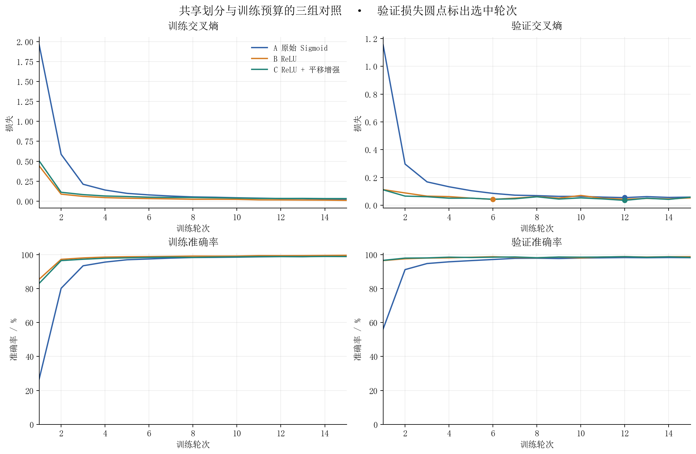
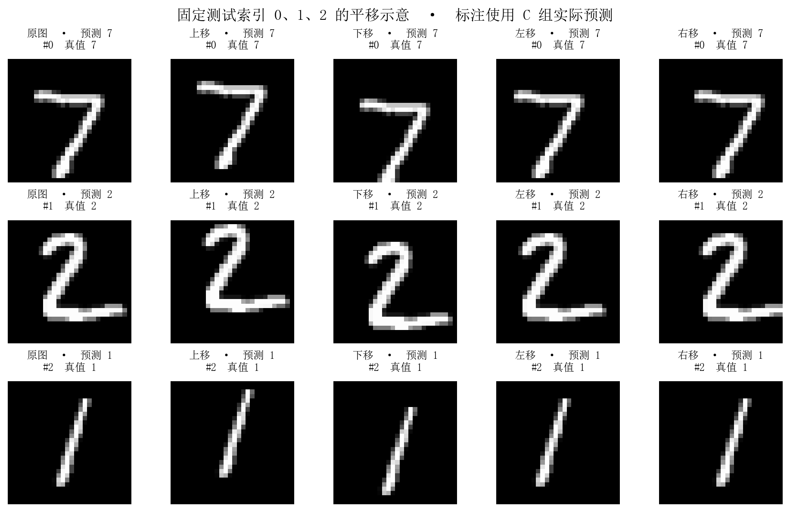
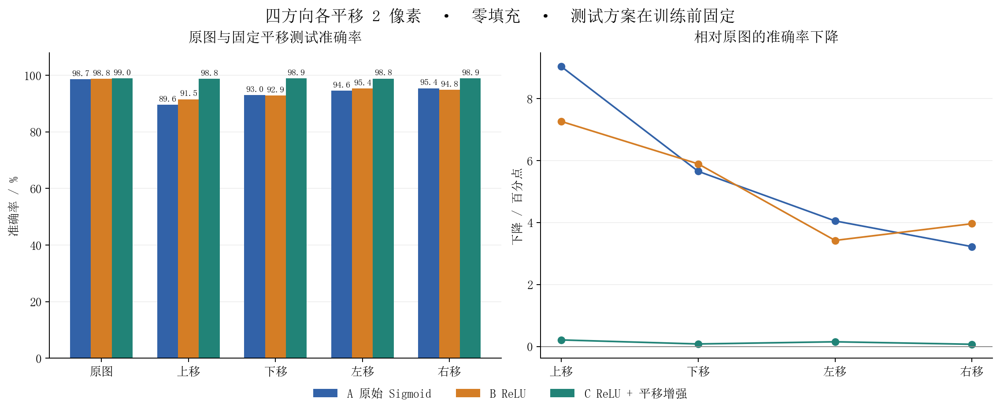
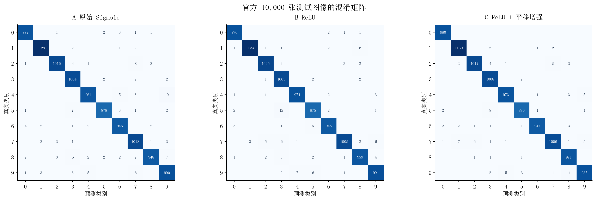
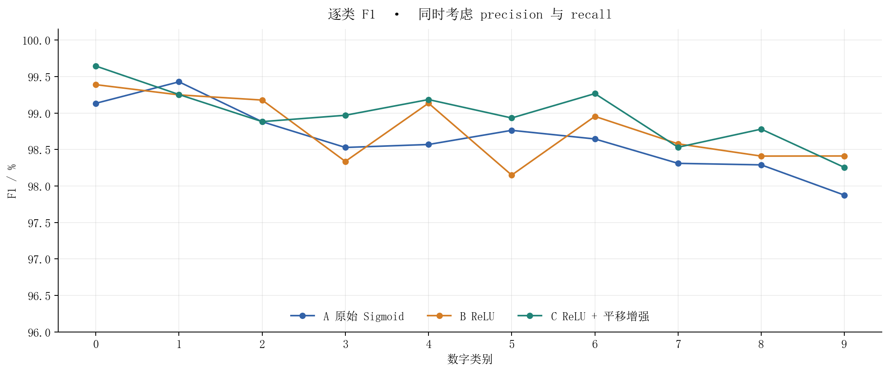
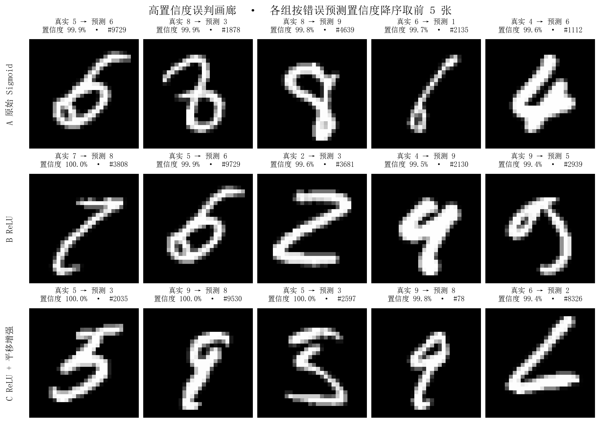
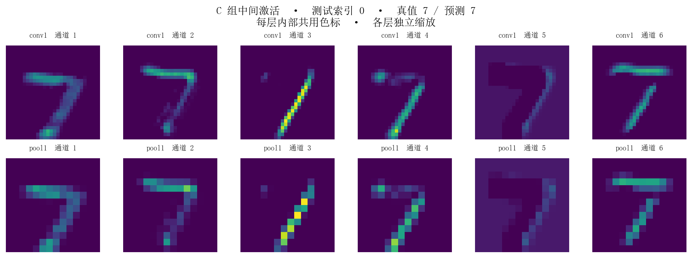
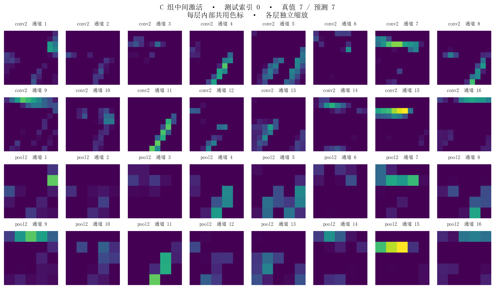

# 从识别正确到位置稳定

## 实验五 卷积神经网络与 MNIST 手写数字识别

**薛昕瑶 · 202410315005 · 人工智能241**

本实验完成课堂 LeNet 网络，在同参数量下比较激活函数与平移增强，并追问一个具体问题——数字整体移动两像素后，预测是否仍然可靠？

三组模型均保留 61,706 个参数。A、B、C 的干净测试准确率分别为 98.65%、98.79%、98.97%。C 相对 A 的干净准确率变化为 +0.32 个百分点，四向 2 像素平移平均准确率变化为 +5.68 个百分点。



## 实验设计

官方训练集的每个数字固定留出 500 张验证图，共 5,000 张，其余 55,000 张参与训练。官方 10,000 张测试图在三组训练结束后统一评估。随机种子为 42，三组都训练 15 轮，批量 512，Adam 学习率 0.01，输入像素除以 255。三组共享初始权重与每轮样本顺序，按最低验证交叉熵选取模型。

| 组别 | 激活函数 | 池化 | 训练增强 | 参数量 |
| --- | --- | --- | --- | --- |
| A 原始 LeNet | Sigmoid | 平均池化 | 无 | 61,706 |
| B ReLU | ReLU | 平均池化 | 无 | 61,706 |
| C ReLU 加平移增强 | ReLU | 平均池化 | 整数平移 ±2 像素 | 61,706 |

A→B 只替换四处隐藏层激活函数。B→C 只增加训练图像平移。三组输出均为 10 维 logits，交叉熵直接接收 logits。

### 数据与模型

| 阶段 | 输出形状 | 可训练参数 |
| --- | --- | --- |
| 输入 | 1×28×28 | 0 |
| Conv1 5×5 padding=2 | 6×28×28 | 156 |
| 激活 + 平均池化 2×2 | 6×14×14 | 0 |
| Conv2 5×5 | 16×10×10 | 2,416 |
| 激活 + 平均池化 2×2 | 16×5×5 | 0 |
| 展平 + FC1 | 120 | 48,120 |
| FC2 | 84 | 10,164 |
| 分类层 | 10 | 850 |

划分指纹为 `bea944120835e8941098faa6008859caafe1e286297718a2d41795c151027ee7`。索引保存在 [split_indices.npz](results/split_indices.npz)，可逐样本重建划分。

## 实测结果

| 组别 | 最优轮次 | 干净准确率 | Macro F1 | 准确率 Wilson 95% 区间 | 平移平均准确率 |
| --- | --- | --- | --- | --- | --- |
| A 原始 LeNet | 12 | 98.65% | 0.9864 | 98.40–98.86% | 93.16% |
| B ReLU | 6 | 98.79% | 0.9878 | 98.56–98.99% | 93.66% |
| C ReLU 加平移增强 | 12 | 98.97% | 0.9897 | 98.75–99.15% | 98.84% |

最优轮次按验证损失选择。每轮损失按样本数加权，准确率按预测正确的图像数量累计。训练曲线中的训练指标来自更新过程中的批次，C 组还包含随机增强，验证指标来自该轮结束后的模型及干净图像。两条曲线口径不同，过拟合判断需要结合各自趋势。

## 两像素平移压力测试

C 组训练时，对每张图独立采样水平和垂直整数位移，范围均为 −2 到 2 像素，空白处补零。验证图保持原样。测试前预先规定上、下、左、右各 2 像素的四种扰动，对同一批 10,000 张图分别评估。四向平均值反映本实验指定平移条件下的表现，四种结果共享原始图像。



| 组别 | 上移 | 下移 | 左移 | 右移 |
| --- | --- | --- | --- | --- |
| A 原始 LeNet | 89.62% | 93.00% | 94.60% | 95.43% |
| B ReLU | 91.53% | 92.90% | 95.37% | 94.83% |
| C ReLU 加平移增强 | 98.76% | 98.89% | 98.82% | 98.90% |



C 与 A 的四向平均准确率相差 +5.68 个百分点。评价增强的作用时，需要同时观察干净图和扰动图的结果。

## 从错误样本解释结果





混淆矩阵行是真实数字、列是预测数字。逐类 F1 结合 precision 和 recall，检查整体准确率是否掩盖个别类别的错误。



误判图对每组分别按预测置信度从高到低选取前五张，置信度相同时按原始测试索引排列。置信度是 Softmax 输出，较高的数值也可能伴随错误。

| 配对比较 | 候选正确而 A 错误 | A 正确而候选错误 |
| --- | --- | --- |
| B ReLU | 77 | 63 |
| C ReLU 加平移增强 | 91 | 59 |

同一张图上比较预测，可保留模型差异的配对信息。这里报告原始计数，单次运行的差异仍需多种子复验。

## 观察特征提取过程





固定使用官方测试索引 0。图中展示激活后的卷积特征和平均池化特征，每层各通道共享该层色标。池化改变空间分辨率，通道响应反映卷积核与输入的数值匹配，语义解释需额外证据。

## 结论与局限

三组模型均保留 61,706 个参数。A、B、C 的干净测试准确率分别为 98.65%、98.79%、98.97%。C 相对 A 的干净准确率变化为 +0.32 个百分点，四向 2 像素平移平均准确率变化为 +5.68 个百分点。

本实验只运行一个随机种子，结论限定于此次固定划分、初始化和训练预算。准确率区间采用 10,000 张测试图上的 Wilson 95% 区间，覆盖测试样本层面的不确定性。跨随机种子的训练波动和其他图像分布需要进一步实验。平移结果只支持预设整数位移条件下的结论，旋转、模糊和真实拍照手写图仍需单独验证。

本次改进体现在可归因的消融、独立验证集、位置扰动评测和可追溯的预测记录。与示例报告的运行环境和数据选择过程存在差异，数值比较以本实验同条件三组对照为依据。

## 运行方法

```bash
python -m pip install -r requirements.txt
python run_experiment.py --epochs 15 --batch-size 512 --seed 42
python verify_results.py
python make_figures.py
```

训练脚本默认从项目 data 目录读取或下载 MNIST。data 目录已加入 gitignore。已执行的 [experiment5.ipynb](experiment5.ipynb) 可直接查看结果，设置 RUN_TRAINING=True 可重新训练。

### 文件导航

- [model.py](model.py) 定义 LeNet 与零填充整数平移。
- [run_experiment.py](run_experiment.py) 完成训练、验证选择和最终评测。
- [results/summary.json](results/summary.json) 保存配置、环境和完整指标。
- [results/histories.csv](results/histories.csv) 保存逐轮训练与验证记录。
- [results/predictions.csv](results/predictions.csv) 保存逐样本原图与扰动图预测。
- [checkpoints](checkpoints) 保存三个按验证损失选出的权重。
- [Word 实验报告](reports/薛昕瑶_202410315005_CNN实验五报告.docx) 可编辑。

## 参考与来源

课堂 PDF 提供 LeNet 基础任务，顾禹东的示例用于了解报告要求。本项目重新组织实现、实验协议与分析，全部结果图来自此次实际运行。

- 课堂参考　实验五参考代码.pdf，LeNet 补全题与特征可视化
- 报告示例　https://github.com/Guyudong1/CV_exp/tree/main/5th.exp
- 固定参考版本　https://github.com/Guyudong1/CV_exp/tree/4c9065cd21ffcdac8e11519fcc384ae94cccabe5/5th.exp
- 交叉熵文档　https://docs.pytorch.org/docs/stable/generated/torch.nn.CrossEntropyLoss.html
- MNIST 接口　https://docs.pytorch.org/vision/stable/generated/torchvision.datasets.MNIST.html
